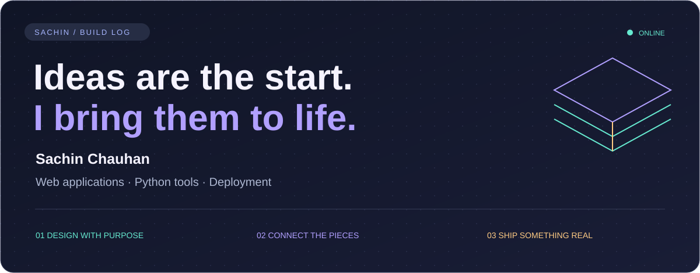
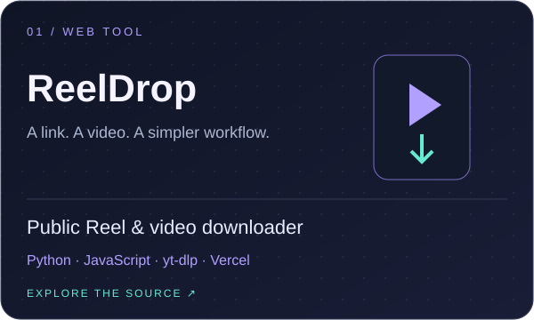
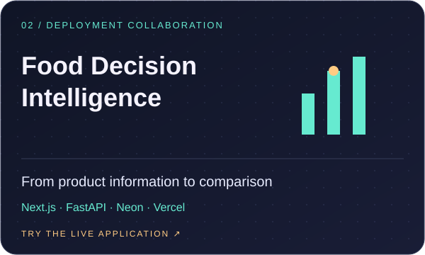
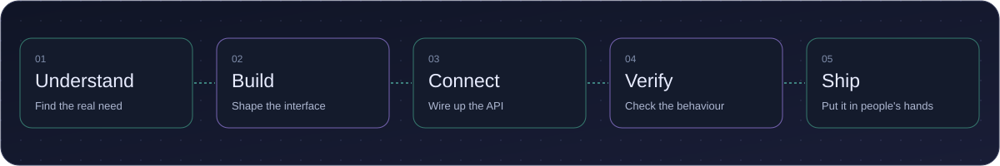

### Making things people can use

I'm **Sachin Chauhan**. I like the moment a project stops being an idea and becomes something you can open, try, and share.

My work brings together web interfaces, APIs, and deployment. I enjoy connecting the pieces, fixing what gets in the way, and making the finished experience easier to use.

Right now, I'm exploring Python and AI-assisted development through practical projects. The projects below show what I've been working on—and link directly to the demos.

 

### Selected work / open it, try it

**01 · ReelDrop**  
A browser interface and Python API for downloading public Instagram videos and Reels using yt-dlp.  
[Source code ↗](https://github.com/sachinchauhan0229-creator/reeldrop) · [Live demo ↗](https://reeldrop-sachin.vercel.app/)  
Use for content you own or have permission to save. Availability depends on Instagram.

**02 · Food Decision Intelligence**  
Deployment and integration work for a packaged-food analysis app: a Next.js frontend, FastAPI backend, and Neon PostgreSQL database.  
[Live demo ↗](https://packed-food-web.vercel.app/) · [Original project ↗](https://github.com/SNEHAJUYAL/packed-food-analysis-Minor-project-)  
Original project by Sneha Juyal, Radhika, and Shinjini. My contribution focuses on bringing the application online and connecting its services.

**03 · JobCraft**  
A free resume and cover-letter builder with editable templates, role-specific examples, career guides, and Hindi resume-writing guidance. Built with HTML, CSS, and JavaScript, with Python-generated pages and deployment on Vercel.  
[Live website ↗](https://jobcraft.in/) · [Resume examples ↗](https://jobcraft.in/sample/) · [Career guides ↗](https://jobcraft.in/guides/)  
No sign-up required. Drafts stay in your browser; download plain text or save as PDF through browser printing.

 

### How I move a project forward

 

### Technologies across these projects

 

### What matters to me

**Useful over complicated.** Start with a problem someone actually has.  
**Connected from end to end.** The interface, API, and deployment should work together.  
**Clear about the limits.** Document what works, what depends on other services, and what still needs attention.

---

<b>Have a look around. The best introduction is a working project.</b>  
<a href="https://github.com/sachinchauhan0229-creator?tab=repositories">REPOSITORIES ↗</a> &nbsp; / &nbsp;
<a href="https://reeldrop-sachin.vercel.app/">TRY REELDROP ↗</a> &nbsp; / &nbsp;
<a href="https://packed-food-web.vercel.app/">TRY FOOD ANALYSIS ↗</a> &nbsp; / &nbsp;
<a href="https://jobcraft.in/">TRY JOBCRAFT ↗</a>

