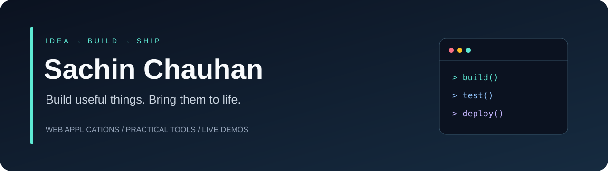

<p align="center">
  <a href="https://github.com/sachinchauhan0229-creator?tab=repositories">Explore my repositories</a>
  &nbsp; · &nbsp;
  <a href="https://reeldrop-sachin.vercel.app/">ReelDrop demo</a>
  &nbsp; · &nbsp;
  <a href="https://packed-food-web.vercel.app/">Food analysis demo</a>
</p>

## Hi, I'm Sachin 👋

I build web applications and practical tools, and enjoy taking projects from an idea to a working deployment. This profile brings together my public work, experiments, and live demos.

- **Current focus:** useful interfaces, API integration, and reliable deployments.
- **Exploring:** AI-assisted development and Python-powered web tools.
- **My approach:** build something small, test the important parts, and improve it with feedback.

## Selected work

### ReelDrop
A web tool for downloading public Instagram videos and Reels, with a browser interface and Python endpoints using yt-dlp.

**Project stack:** HTML · JavaScript · Python · Vercel  
[View source](https://github.com/sachinchauhan0229-creator/reeldrop) · [Open demo](https://reeldrop-sachin.vercel.app/)

<sub>For content you own or have permission to save. Availability depends on the source platform.</sub>

### Food Decision Intelligence — deployment collaboration
Helped bring a packaged-food analysis project online with a Next.js frontend, FastAPI backend, and Neon PostgreSQL database. Browse product reports and compare products within the same category.

**Project stack:** Next.js · TypeScript · FastAPI · PostgreSQL · Vercel  
[Open demo](https://packed-food-web.vercel.app/) · [Original project](https://github.com/SNEHAJUYAL/packed-food-analysis-Minor-project-)

<sub>Original project by Sneha Juyal, Radhika, and Shinjini. My contribution here focuses on deployment setup and integration.</sub>

## From idea to live application

```text
Understand the problem → Build the interface → Connect the API → Test → Deploy → Improve
```

I value clear documentation, honest limitations, and demos people can actually try.

---

<p align="center"><sub>Thanks for visiting. Explore the projects, try a demo, or open an issue on a public repository.</sub></p>
